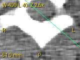
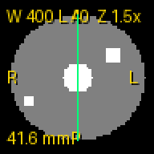
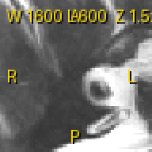

# viewer-vigilance-kit

Release support for a medical imaging viewer, as a small working project:

1. **Vigilance monitor** (`vigil/`): pulls public incident data for image-viewing and
   image-processing software from openFDA (MAUDE adverse events, device recalls) and from
   BfArM field safety notices, maps everything to one incident schema, removes duplicates,
   remembers what was already reported, tags each item with transparent regex rules and writes
   a weekly digest (Markdown + CSV). A scheduled GitHub Actions workflow runs it every Monday.
2. **Viewer core + release testing** (`viewer/`, `tests/`): a minimal DICOM viewer core
   (pydicom + numpy + Pillow) with series sorting, rescale, window/level, zoom, pan, contrast,
   orientation labels and mm measurement; a three-tier test suite (smoke, unit, golden image);
   a planted-defect study that measures how many realistic viewer bugs each tier catches; a
   release-candidate gate, a requirement-to-test traceability check and a tag-driven release
   workflow.

Live results page: https://huggingface.co/spaces/pavanyadava07/viewer-vigilance-kit

> Not a medical device. Not validated for clinical use. The release checklist and trace matrix
> are structured like medical-software practice, but they are engineering evidence for a
> portfolio project, not regulatory documents.

## Quick start

```bash
uv sync --extra dev            # Python 3.11, locked dependencies
make lint test                 # ruff check, ruff format --check, pytest
make corpus                    # fetch the evaluation corpus (network, cached, rate limited)
make results-offline           # tagger eval + defect study + trace matrix + README tables
make digest                    # live run of the vigilance monitor (network)
make rc                        # release-candidate gate, writes reports/rc/

# render a DICOM file or series with overlays
.venv/bin/dicomview tests/data/phantom_axial -o axial.png --size 192 192 --zoom 2 \
    --measure 6 32 58 32
```

`make results` additionally re-verifies the FDA product codes and refreshes the evaluation
corpus from the live APIs (rate limited to one request per second per host, raw responses
cached under `data/raw/`, which is not committed).

## Architecture

```
openFDA classification -> verified product codes (vigil/config.yaml)
openFDA MAUDE events  --\
openFDA recalls       ---+-> Incident schema -> dedupe -> rule tagger -> state (new only) -> digest .md/.csv
BfArM RSS + detail    --/                       (vigil/rules.yaml)      (data/state.json)    (reports/)
BfArM list pages (backfill corpus) -> scripts/eval_tagger.py -> results/tagger_eval.json

DICOM files -> read_slice (rescale) -> sort_slices (position along normal) -> window/level
            -> viewport (zoom about centre, pan) -> image layer  + overlay spec (labels, W/L, mm)
tests: smoke | unit (hand-checked values) | golden (exact pixels + exact overlay spec)
viewer/_defects.py: 15 planted bugs, switched on one at a time by scripts/run_mutants.py
scripts/rc_gate.py: lint + tests + traceability + defect study + version check -> report
```

| Path | Purpose |
|---|---|
| `vigil/fda.py`, `vigil/bfarm.py` | fetchers and parsers |
| `vigil/schema.py`, `vigil/state.py` | incident schema, dedupe, "new since last run" |
| `vigil/rules.yaml`, `vigil/tagger.py` | relevance flag and categories |
| `vigil/weak_labels.yaml` | agency labels used only for evaluation |
| `vigil/digest.py`, `vigil/cli.py` | digest writer, `vigil run` / `vigil corpus` |
| `viewer/core.py`, `viewer/render.py`, `viewer/cli.py` | viewer core, overlays, `dicomview` |
| `requirements.yaml`, `scripts/traceability.py` | requirement IDs mapped to tests |
| `RELEASE_CHECKLIST.md`, `scripts/rc_gate.py`, `scripts/release_notes.py` | release process |
| `.github/workflows/` | `ci.yml`, `vigilance-weekly.yml`, `release.yml` |

## Sources and product codes

FDA product codes were chosen by querying the openFDA classification endpoint for the
radiology image-software regulations (21 CFR 892.2010 to 892.2050) and checking each name
(`scripts/verify_product_codes.py`, output in `results/product_codes.json`):

<!-- BEGIN product_codes -->
| Code | Official name (openFDA classification) | Regulation | Class | Verified |
|---|---|---|---|---|
| LLZ | System, Image Processing, Radiological | 21 CFR 892.2050 | 2 | yes |
| LMD | System, Digital Image Communications, Radiological | 21 CFR 892.2020 | 1 | yes |
| LMB | Device, Digital Image Storage, Radiological | 21 CFR 892.2010 | 1 | yes |
| PGY | Display, Diagnostic Radiology | 21 CFR 892.2050 | 2 | yes |
| QIH | Automated Radiological Image Processing Software | 21 CFR 892.2050 | 2 | yes |
<!-- END product_codes -->

BfArM: the RSS feed of manufacturer measures gives the newest 20 notices; each notice's detail
page gives the agency's Produktgruppe and Referenznummer. The HTML list (10 pages of 50) is used
to build a larger corpus for evaluation. Only the notice title is machine-readable; the
manufacturer letter itself is a PDF and is not parsed.

## Measured results

All numbers below are rendered by `scripts/render_results.py` from `results/*.json`.

### Evaluation corpus

<!-- BEGIN fetch -->
Corpus fetched on 2026-10-05.

| Source | Query window | Items | Item dates |
|---|---|---:|---|
| FDA_MAUDE | date_received 2025-10-05 to 2026-10-05 | 483 | 2025-10-06 to 2026-08-31 |
| FDA_RECALL | event_date_initiated 2024-10-05 to 2026-10-05 | 53 | 2024-10-10 to 2026-07-31 |
| BFARM_FSN | list pages 1-10 (50 per page) | 500 | 2026-02-05 to 2026-10-02 |

| Product code | MAUDE reports | Recall records |
|---|---:|---:|
| LLZ | 426 | 52 |
| LMD | 51 | 0 |
| LMB | 3 | 0 |
| PGY | 0 | 0 |
| QIH | 3 | 1 |

Duplicates removed: 0.
<!-- END fetch -->

### Tagger against agency weak labels

No hand labels are used. The labels come from the agencies:

- **BfArM**: the agency's own Produktgruppe for each notice. Label A = "Radiologische Technik";
  label B = A plus "Medizinische Datenverarbeitung (Software)" plus "Ultraschalltechnik". The
  flag tested is the rule-based "software / imaging relevant" flag on the title text only.
- **MAUDE**: the FDA product_problems terms on each report, mapped to the viewer categories in
  `vigil/weak_labels.yaml`. The tagger sees only the narrative text, never the problem terms.
- Split: 50/50 by hash of the incident id. Rules were written from domain knowledge first; a
  few lines (marked "dev-split change" in `rules.yaml`) were edited after reading errors on
  the dev split only. The test split was not inspected.

<!-- BEGIN tagger -->
BfArM notices 2026-02-05 to 2026-10-02; text = notice title (product + manufacturer).

| Weak label (agency Produktgruppe) | Split | n | Positives | Precision | Recall | F1 |
|---|---|---:|---:|---:|---:|---:|
| A: Radiologische Technik | dev | 249 | 15 | 0.250 | 0.400 | 0.308 |
| A: Radiologische Technik | test | 251 | 18 | 0.353 | 0.333 | 0.343 |
| A: Radiologische Technik | all | 500 | 33 | 0.293 | 0.364 | 0.324 |
| B: A + Med. Datenverarbeitung (Software) + Ultraschalltechnik | dev | 249 | 35 | 0.542 | 0.371 | 0.441 |
| B: A + Med. Datenverarbeitung (Software) + Ultraschalltechnik | test | 251 | 40 | 0.647 | 0.275 | 0.386 |
| B: A + Med. Datenverarbeitung (Software) + Ultraschalltechnik | all | 500 | 75 | 0.585 | 0.320 | 0.414 |

MAUDE reports 2025-10-06 to 2026-08-31: 483 reports, 424 with narrative text. Tagger reads the narrative only; label = FDA product_problems terms mapped to categories (vigil/weak_labels.yaml).

| Category | Test positives | Test precision | Test recall | Dev positives | Dev precision | Dev recall |
|---|---:|---:|---:|---:|---:|---:|
| image_display | 46 | 0.370 | 0.217 | 49 | 0.462 | 0.245 |
| wrong_patient | 3 | 0.250 | 0.333 | 1 | 0.000 | 0.000 |
| measurement | 3 | 0.250 | 1.000 | 5 | 0.200 | 0.400 |
| orientation_laterality | 1 | 0.000 | 0.000 | 0 | 0.000 | n/a |
| data_loss | 5 | 0.056 | 0.200 | 1 | 0.000 | 0.000 |
| performance_freeze | 11 | 0.095 | 0.182 | 7 | 0.118 | 0.286 |
| interoperability | 58 | 0.589 | 0.569 | 48 | 0.558 | 0.500 |
| cybersecurity | 21 | 0.941 | 0.762 | 27 | 0.923 | 0.889 |
| **micro, test** | 148 | 0.423 | 0.446 | | | |
| **micro, dev** | 138 | 0.464 | 0.464 | | | |
<!-- END tagger -->

What this says: title-only keyword rules are a weak relevance filter for BfArM (most titles
are product names such as "Azurion" or "AW Server"). The monitor therefore marks a BfArM
notice relevant if the agency's Produktgruppe is in the configured list **or** the rules match
(the rules add e.g. MR systems that BfArM files under "Elektro-Magnetische Felder"). For MAUDE,
cybersecurity and interoperability are tagged reasonably; the rarer categories have very few
positives, so their numbers are not stable, and the FDA problem terms themselves are noisy.

### Test suite strength (planted defects)

Each defect is a realistic viewer bug behind a switch in `viewer/_defects.py` (off unless
`VIEWER_DEFECT` is set). `scripts/run_mutants.py` turns them on one at a time and runs each
tier; a baseline run with no defect must pass first.

<!-- BEGIN mutants -->
| Tier | Tests run | Defects caught | Catch rate |
|---|---:|---:|---:|
| Smoke only | 6 | 0/15 | 0% |
| Smoke + unit | 42 | 15/15 | 100% |
| Smoke + unit + golden | 59 | 15/15 | 100% |
| Golden only (extra view) | 17 | 15/15 | 100% |

| Planted defect | What it does | Failing tests: smoke / unit tier / full / golden only |
|---|---|---|
| `ignore_rescale_intercept` | Rescale Intercept ignored (CT values off by +1024 HU) | 0 / 5 / 10 / 5 |
| `rescale_in_storage_dtype` | rescale done in uint16 storage dtype, negative HU wrap around | 0 / 2 / 4 / 2 |
| `swap_pixel_spacing` | row and column PixelSpacing swapped in measurements | 0 / 2 / 3 / 1 |
| `measurement_ignores_spacing` | distance reported in pixels instead of mm | 0 / 2 / 4 / 2 |
| `flip_lr_letter` | patient x axis mapped to R instead of L in orientation labels | 0 / 4 / 10 / 6 |
| `top_bottom_labels_swapped` | top and bottom orientation labels swapped | 0 / 2 / 9 / 7 |
| `sort_by_filename` | series sorted by file name instead of slice position | 0 / 4 / 7 / 3 |
| `sort_by_z_only` | series sorted by z coordinate instead of position along the normal | 0 / 1 / 2 / 1 |
| `window_off_by_one` | window uses width instead of width-1 and centre instead of centre-0.5 | 0 / 3 / 8 / 5 |
| `multivalue_window_ignored` | multi-valued WindowCenter/Width ignored, falls back to min/max | 0 / 2 / 6 / 4 |
| `ignore_monochrome1` | MONOCHROME1 images not inverted | 0 / 1 / 2 / 1 |
| `contrast_inverted` | contrast factor widens the window instead of narrowing it | 0 / 1 / 3 / 2 |
| `zoom_about_origin` | zoom anchored at the top-left corner instead of the image centre | 0 / 2 / 4 / 2 |
| `pan_sign_flipped` | pan moves the image opposite to the drag direction | 0 / 1 / 3 / 2 |
| `vertical_flip_render` | rendered rows written bottom-up | 0 / 3 / 9 / 6 |
<!-- END mutants -->

Caveat: the same author wrote the defects and the tests, so the unit tier was written with
these bug classes in mind. The smoke tier (does it load and render) caught none of them, which
is the useful contrast: a viewer can render a plausible image with wrong HU values, swapped
laterality or wrong measurements. The golden tier compares the exact pixel layer and the exact
overlay description (orientation letters, W/L text, measurement line and value), so it does not
depend on font rasterisation.

### Tests and traceability

<!-- BEGIN tests -->
72 collected test items (51 test functions): 6 smoke, 36 unit, 17 golden, 13 vigilance-monitor tests. 16 requirements, all traced: True.
<!-- END tests -->

### Weekly digest sample

<!-- BEGIN digest -->
First run on 2026-10-05 (empty state, so every item in the window is new).

| Source | Items | Item dates |
|---|---:|---|
| FDA_MAUDE | 108 | 2026-07-07 to 2026-08-31 |
| FDA_RECALL | 11 | 2026-06-19 to 2026-07-31 |
| BFARM_FSN | 20 | 2026-09-22 to 2026-10-02 |

Items flagged viewer/imaging relevant: 125.
<!-- END digest -->

The full sample is in `reports/sample/digest-sample.md` and `.csv`. Later runs only list items
whose uid is not in the state file; on GitHub the state persists through the Actions cache.

## Viewer examples

Rendered with overlays (orientation letters, window/level, zoom, measurement in mm):

| CT (pydicom CT_small), zoom 2.5, pan, W 400 L 40, measurement | Synthetic axial phantom, slice 3, measurement | MR (pydicom MR_small) |
|---|---|---|
|  |  |  |

## Test data

- pydicom's bundled test files: `CT_small.dcm`, `MR_small.dcm` and the 5-slice series
  `dicomdirtests/98892001/CT5N` (shipped with pydicom, MIT licensed package).
- `tests/data/`: synthetic phantoms generated by `scripts/make_phantom.py` (deterministic, no
  patient data): an 8-slice axial series with uint16 storage, intercept -1024, anisotropic
  pixel spacing (0.8 x 0.5 mm), multi-valued window tags and file names out of spatial order;
  a 5-slice sagittal series; one MONOCHROME1 image.
- `tests/fixtures/`: small snapshots of openFDA and BfArM responses so the monitor tests run
  offline (contact fields removed from the FDA records).
- `data/corpus.jsonl` (not committed): the evaluation corpus, rebuilt from the public APIs
  with `make corpus`; `results/fetch_summary.json` records the query windows and counts.

## Release process

- `ci.yml`: lint, tests and traceability on every push and pull request.
- `release.yml` on a `v*` tag: runs `scripts/rc_gate.py` (lint, format, all tests with JUnit
  XML, trace matrix, defect study must catch every planted defect, version equals tag), builds
  wheel and sdist, writes release notes from conventional commits and attaches the test report,
  trace matrix, defect study and a digest sample to the GitHub Release.
- `RELEASE_CHECKLIST.md`: the human checklist for a release candidate.

## Limits

- Weak labels, not ground truth: Produktgruppe and FDA problem terms are assigned by agencies
  and reporters for their own purposes. Precision and recall above measure agreement with them.
- Small data: 500 BfArM notices (what the list exposes), one year of MAUDE for five product
  codes, two years of recalls. openFDA MAUDE data lags; the newest report in the corpus is from
  2026-08-31.
- BfArM text is only the notice title; the PDF letter is not parsed.
- Only openFDA and BfArM are covered. Other registers can be added as another fetcher that
  returns `Incident` objects.
- The viewer core is minimal: no multi-frame, no compressed transfer syntaxes beyond what
  pydicom decodes by default, nearest-neighbour zoom only, no presentation states.
- Not a medical device and not validated for clinical use.

## License

MIT for the code. openFDA data is public domain (U.S. FDA); BfArM content belongs to BfArM and
is referenced by link with only titles and metadata stored.
